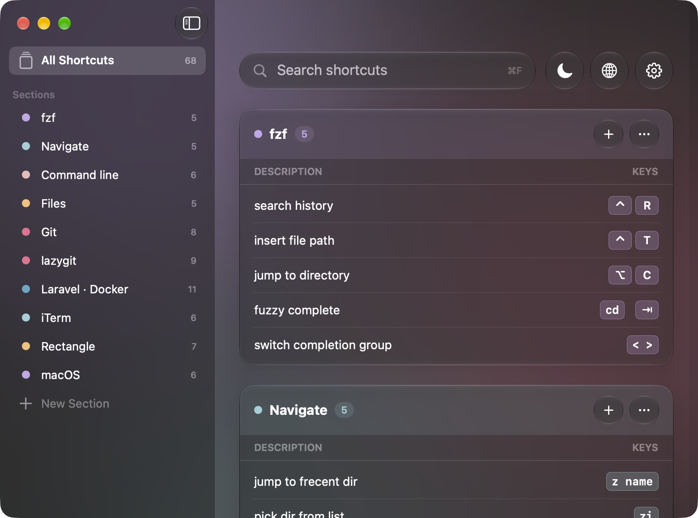
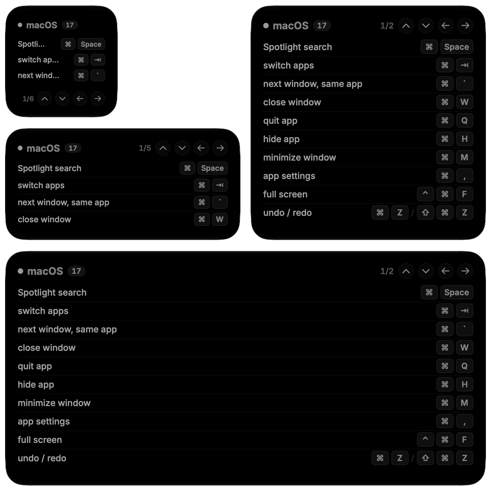

# Shortcut Divan

Your keyboard shortcuts in a macOS desktop widget, and a small app to browse, search and edit them.
English and Persian.

[فارسی](#دیوان-میانبر)





## What it does

- **Desktop widget** in four sizes. Pick which section it shows; extra large shows two.
- **Page and section buttons** on the widget: widgets can't scroll, so long sections page.
- **Click the widget** to open the app on that section: everything, searchable.
- **Add, edit and delete** shortcuts and sections, with buttons for ⌘ ⌥ ⇧ ⌃ and the arrows.
- **Starts with the everyday macOS shortcuts**; add your own apps and tools.
- **Follow a file:** keep your shortcuts in a JSON file (a dotfiles repo, a synced folder). The
  app reads it, watches it, and saves your edits back to it.
- **Import and export** that same JSON.

## Install

With [Homebrew](https://brew.sh):

```sh
brew install --cask codingwithsaeed/tap/shortcut-divan
```

Then open it once, and right-click the desktop › **Edit Widgets** › **Shortcut Divan**.
`brew upgrade --cask shortcut-divan` updates it.

Or by hand:

1. Download `Shortcut-Divan-<version>.dmg` from [Releases](../../releases/latest) and drag the
   app to Applications.
2. The app isn't signed with an Apple Developer ID, so the first time macOS refuses to open it.
   Open **System Settings › Privacy & Security** and click **Open Anyway** next to Shortcut
   Divan. Or, in Terminal:

   ```sh
   xattr -dr com.apple.quarantine "/Applications/Shortcut Divan.app"
   ```

3. Open it once, then right-click the desktop › **Edit Widgets** › **Shortcut Divan**.

Requires macOS 14 or later.

## Your shortcuts

They're saved in `~/Library/Application Support/Shortcut Divan/shortcuts.json`, one shortcut per
line, easy to edit by hand:

```json
{
  "sections": [
    {
      "title": "macOS",
      "accent": "iris",
      "rows": [
        { "keys": "⌘␣", "desc": "Spotlight search" }
      ]
    }
  ]
}
```

`accent` is one of `love`, `gold`, `rose`, `pine`, `foam`, `iris` (Rosé Pine colors). `␣` shows
as "Space".

To keep them somewhere else, use **File › Follow a Shortcuts File…**.

## Build from source

Needs Xcode and [XcodeGen](https://github.com/yonaskolb/XcodeGen) (`brew install xcodegen`):

```sh
./scripts/install.sh
```

It builds the app and installs it into `~/Applications`.

## Releasing

Publishing a GitHub release builds the app (universal, signed ad hoc) and attaches the `.dmg` to
it:

```sh
gh release create v1.0.0 --generate-notes
```

It also updates the Homebrew cask in
[codingwithsaeed/homebrew-tap](https://github.com/codingwithsaeed/homebrew-tap), from
`packaging/homebrew/shortcut-divan.rb`, when the `HOMEBREW_TAP_TOKEN` secret is set.

## License

MIT

---

<div dir="rtl">

## دیوان میان‌بر

میان‌برهای صفحه‌کلیدتان در یک ویجت روی دسکتاپ مک، و برنامه‌ای کوچک برای دیدن، جست‌وجو و ویرایش آن‌ها. به دو زبان فارسی و انگلیسی.

### چه می‌کند

- **ویجت دسکتاپ** در چهار اندازه. هر ویجت یک بخش را نشان می‌دهد و اندازهٔ خیلی بزرگ دو بخش را.
- **دکمه‌های ورق زدن و بخش بعدی** روی خود ویجت، چون ویجت‌ها اسکرول ندارند.
- **کلیک روی ویجت** برنامه را روی همان بخش باز می‌کند، با همهٔ میان‌برها و جست‌وجو.
- **افزودن، ویرایش و حذف** میان‌برها و بخش‌ها، با دکمه برای علامت‌هایی مثل ⌘ و ⌥ و فلش‌ها.
- **میان‌برهای پایهٔ مک** از اول آماده‌اند و بقیه را خودتان اضافه می‌کنید.
- **دنبال کردن یک فایل:** اگر میان‌برها را در فایلی جای دیگر نگه می‌دارید (مثلاً ریپوی تنظیمات)، برنامه همان را می‌خواند، تغییراتش را دنبال می‌کند و ویرایش‌هایتان را در همان ذخیره می‌کند.
- **ورود و خروجی گرفتن** با همان قالب فایل.

### نصب

با هوم‌برو این دستور را اجرا کنید:

</div>

```sh
brew install --cask codingwithsaeed/tap/shortcut-divan
```

<div dir="rtl">

بعد برنامه را یک‌بار باز کنید و ابزارک را از منوی ویرایش ویجت‌های دسکتاپ اضافه کنید. برای به‌روزرسانی هم دستور ارتقای هوم‌برو کافی است.

یا به‌صورت دستی:

۱. فایل نصبی را از [صفحهٔ انتشارها](../../releases/latest) بگیرید و برنامه را به پوشهٔ برنامه‌ها بکشید.

۲. برنامه با حساب توسعه‌دهندهٔ اپل امضا نشده، پس مک بار اول بازش نمی‌کند. به تنظیمات سیستم، بخش حریم خصوصی و امنیت بروید و کنار اسم برنامه روی «باز کردن در هر صورت» بزنید. یا این دستور را در ترمینال اجرا کنید:

</div>

```sh
xattr -dr com.apple.quarantine "/Applications/Shortcut Divan.app"
```

<div dir="rtl">

۳. برنامه را یک‌بار باز کنید. بعد روی دسکتاپ راست‌کلیک کنید، «ویرایش ویجت‌ها» را بزنید و «دیوان میان‌بر» را اضافه کنید.

برنامه به نسخهٔ ۱۴ مک یا جدیدتر نیاز دارد.

### زبان

برنامه با زبان سیستم باز می‌شود. برای اینکه فقط این برنامه فارسی باشد، در تنظیمات سیستم به بخش زبان و منطقه بروید و در قسمت برنامه‌ها، زبان «دیوان میان‌بر» را فارسی کنید.

</div>
